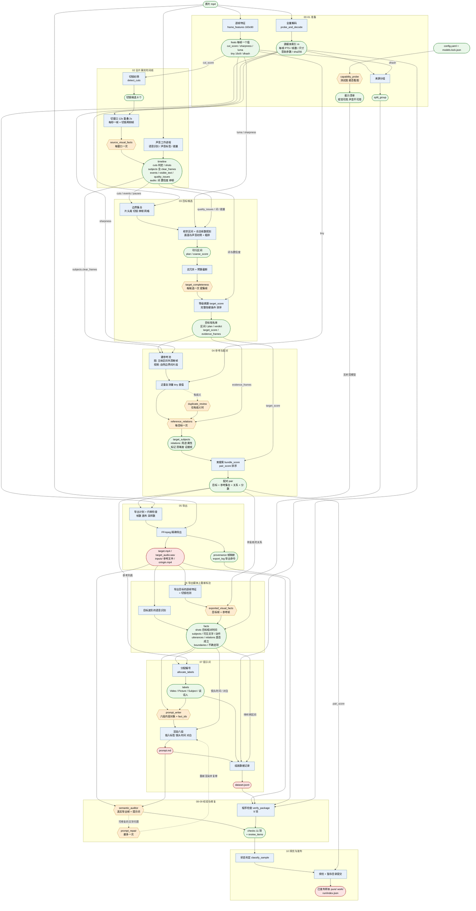

# stapipe-v1 数据流

本文用一张有向无环图说明已实现的流水线（[stapipe/](stapipe/)）里数据从哪里来、被谁使用，并逐项列出每个数据特征的来历。设计与取舍见 [README.md](README.md)，讲解视频的旁白见 [video/pipeline/narration.md](video/pipeline/narration.md)。

图中方框是程序计算，六边形是模型调用，圆角框是数据。箭头表示“由谁产生、被谁使用”。示例数字来自对一条 30 秒短片的真实运行（750 帧，25 FPS，小预算配置 `config.smoke.yaml`）。



## 每个数据特征的来历

### 节点 00 到 01：从原片直接量出来的

代码：[media.py](stapipe/media.py)、[source.py](stapipe/source.py)、[models.py](stapipe/models.py)

| 数据 | 怎么来的 | 谁在用 |
| --- | --- | --- |
| 每帧 PTS、帧数、尺寸、音轨参数 | FFmpeg 把原片完整解码一遍时记录 | 所有“帧号与秒数互换”的地方 |
| `sha256` | 对原片文件算哈希 | 来源分组、溯源、缓存键 |
| `cut_score` | 相邻两帧的像素差加颜色直方图差 | 切镜初筛 |
| `sharpness` | 160×90 灰度图做拉普拉斯滤波后的方差 | 模糊初筛、粗排、参考图排序、选缩略图 |
| `luma` | 灰度图的平均亮度 | 黑屏初筛 |
| `tiny` | 16×9 的灰度缩略图 | 近重复检查、帧映射核对 |
| `dhash` | 8×8 网格的明暗比较哈希 | 来源分组的画面指纹 |
| `split_group` | 配置的作品标识，否则查登记表，否则用原片哈希 | 写入数据记录 |
| 能力清单 | 用一张测试图实测模型能否看图；声音节点未配置后端 | 决定分支和是否启用参考音轨 |

### 节点 02：时间线

代码：[source.py](stapipe/source.py)、[audio_worker.py](stapipe/audio_worker.py)

| 数据 | 怎么来的 |
| --- | --- |
| 切镜候选 | 程序：`cut_score` 超过阈值且明显高于前后邻帧 |
| 切镜判定、镜头 | 模型看候选前后两帧判定；全部窗口都确认的才算切镜，程序据此切出镜头 |
| 主体及其清晰帧 | 模型在抽样帧上登记；键名跨窗口沿用 |
| 事件、可见文字、画质问题 | 模型在抽样帧上描述 |
| 词与置信度 | 语音识别（Whisper），没有模型听过 |
| 声音标签 | 声音分类（CLAP），只作线索 |
| 停顿 | 程序：词之间的间隙，加上能量曲线的低谷 |

给模型看的帧由程序固定决定：每个 12 秒窗口内每秒一帧，加上窗口内每个切镜候选的前后两帧，一个窗口一次调用。

### 节点 03：目标

代码：[targets.py](stapipe/targets.py)、[planning.py](stapipe/planning.py)

| 数据 | 怎么来的 |
| --- | --- |
| 边界集合 | 程序：片头尾、确认的切镜、完成的事件、停顿中点、0.25 秒网格 |
| `plan` | 程序：枚举 `17k+5`，选补齐最少且不超限的帧数 |
| `coarse_score` | 程序：两端边界权重、是否落在语音中间、清晰度 |
| `verdict` | 模型看区间内密集帧和前后各一帧，给离散等级 |
| 声音可标注性 | 程序：区间内有没有词、最低置信度 |
| `target_score` | 程序：四个等级加权 |

示例运行的数量变化：129 个边界两两配对得到 8256 个区间；其中 2414 个太短、2017 个太长，3079 个排不出合法帧数，剩下 746 个可行区间；粗排并去冗余后 10 个交给模型评估，8 个完整，前 3 个进入短名单。

### 节点 04：参考与配对

代码：[references.py](stapipe/references.py)

| 数据 | 怎么来的 |
| --- | --- |
| 图片候选 | 程序：目标主体在区间外的清晰帧，按 `sharpness` 轮流取 |
| 视频候选 | 程序：自然边界之间、时长与帧数合法、不与目标相交的片段 |
| 近重复结论 | 程序用 `tiny` 比差值；有歧义时模型看成对的帧 |
| `target_subjects`、`relations` | 模型对照目标帧和参考帧判定 |
| `bundle_score`、`pair_score` | 程序：覆盖率、清晰度等级、证据帧数量，再与目标分加权 |

```text
bundle_score = 0.50 × 主要主体覆盖率 + 0.30 × 清晰度 + 0.20 × 证据 − 0.05 × 冗余参考数
pair_score   = 0.60 × target_score + 0.40 × bundle_score
```

### 节点 05 到 07：导出、事实、提示词

代码：[build.py](stapipe/build.py)、[prompt.py](stapipe/prompt.py)

| 数据 | 怎么来的 |
| --- | --- |
| 导出计划 | 程序：由配对的帧区间和 `plan` 算出画布、帧数、采样数 |
| 媒体文件 | FFmpeg 按计划从原片裁切、缩放、补齐 |
| 帧映射、导出命令 | 导出时记录每个输出帧对应哪个源帧 |
| 导出目标的镜头 | 程序在导出文件上重新检测切镜，模型确认 |
| 对白 | 对导出的目标波形重新做语音识别；含低置信词的整句不写入提示词，只记录待听辨区间 |
| 关系是否成立 | 模型在导出帧上重新核对节点 04 的每条关系 |
| 编号表 | 程序：参考文件按类型连续编号，主体按首次出现排，说话人按首次发声排 |
| 六段内容 | 模型根据事实表写，每句关联事实编号 |
| 最终提示词 | 程序把段名、标签、镜头时间、对白标签拼进去 |
| 数据记录 | 程序：提示词、参考列表、目标实测参数、来源分组、待听辨区间 |

### 节点 08 到 10：检查与发布

代码：[verify.py](stapipe/verify.py)、[publish.py](stapipe/publish.py)

| 数据 | 怎么来的 |
| --- | --- |
| 审查问题清单 | 模型看真实导出帧和提示词，逐项核对 |
| 9 项程序类检查 | 程序重新解码所有导出文件，对照数据记录、帧映射和源媒体索引 |
| 2 项语义检查 | 由审查结果和未解决的不确定项汇总；声音一项因为没有听音模型而为未检查 |
| 最终状态 | 程序按检查结果和待复核项判定 |
| 已发布样本 | 程序从通过的结果里择优，暂存目录整体提交 |

## 模型调用次数由什么决定

调用次数与切点数量无关，每一类的上限都在运行前由配置确定。下表是示例运行的实际次数。

| 模型节点 | 次数 | 按什么调用 |
| --- | --- | --- |
| `source_visual_facts` | 3 | 每个窗口一次 |
| `target_completeness` | 10 | 每个入选候选区间一次，上限 `target_evaluation_budget` |
| `duplicate_review` | 1 | 只有近重复检查有歧义的参考才调用 |
| `reference_relations` | 3 | 短名单里每个目标一次，上限 `shortlist_targets` |
| `exported_visual_facts` | 2 | 每个导出的配对一次，可因漏检切镜重跑一次 |
| `prompt_writer` | 2 | 每个导出的配对一次，上限 `export_pair_budget` |
| `semantic_auditor` | 3 | 每个配对一次，修复后再审一次 |
| `prompt_repair` | 2 | 每个配对最多一次 |

## 读图时值得注意的三点

- **原片被读了多次，但每次目的不同。** 解码索引、逐帧特征、声音证据、抽帧给模型、最终导出，都是直接从原片取，中间不传递图像数据，只传帧号和区间。
- **模型的输出从不直接变成结论。** 每个六边形后面都跟着一个程序节点，把等级换成分数、把内容拼成格式，或者把问题清单变成状态。
- **节点 06 是一个断点。** 在它之前，所有事实的坐标是原片的帧号和秒数；从它开始，镜头、对白、主体都是在导出文件上重新得到的，坐标是目标的 0 秒起算。节点 02 的时间线只用于选材，不会直接写进提示词。

两个声音模型节点（`source_audio_facts`、`exported_audio_facts`）在代码里有调用位置，但默认的 `models.lock.json` 没有给它们配置后端，所以图里没有画成六边形，只用“无听音模型”这条边表示它的影响：样本最高只能到 `needs_review`。
