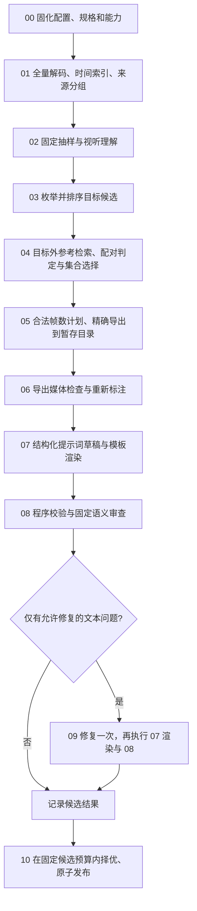

# Ref2VA 静态数据构造流水线设计

本文把 [任务要求](../ref2va-workspace/PROMPT.md) 转成一个由程序调度的固定工作流。配套控制逻辑见 [pipeline.pseudo.py](pipeline.pseudo.py)（设计伪代码）。可运行的第一版实现位于 [stapipe/](stapipe/)，用法、与设计的差异和已做的验证见[第 10 节](#10-实现与运行stapipe-v1)。

首次阅读可以先看 [具体样例走读：raw_video → 训练样本](WALKTHROUGH.md)，用已有广告视频逐节点理解输入、选择、导出、提示词和训练入口的质量检查。

也可以观看 [中文讲解视频（MP4）](walkthrough.mp4)，配套旁白、字幕与制作方式见 [video/README.md](video/README.md)。

这里的“静态”指：**节点、依赖、条件分支、候选搜索方法、重试范围和退出条件在运行前确定；模型负责理解和标注，程序负责决定下一步。** 可以使用不可解释的视觉、声音、嵌入和语言模型，无须把语义判断改成纯规则。大语言模型（LLM，large language model）不会获得任意工具调用权，也不会规划或修改工作流。

## 1. 任务边界与交付契约

输入一个真实视频，输出“参考素材 + H3 提示词 → 从原片提取的目标音视频”的本地配对数据。默认最多一条，优先质量；目标必须有真实源音轨。不调用 H3 生成视频，不加载 H3 权重，不执行训练。

规范依据固定为 workspace 内的快照：

- [PROMPT.md](../ref2va-workspace/PROMPT.md)：任务、质量和输出要求。
- [media-profile.md](../ref2va-workspace/reference/media-profile.md)：本地媒体配置。
- [input-specs.md](../ref2va-workspace/reference/minimax-h3/input-specs.md)：H3 输入规格。
- [Ref2VA 提示词指南](../ref2va-workspace/reference/minimax-h3/skills/h3-prompt-writing/references/ref-en.txt)及[基础声音与镜头规则](../ref2va-workspace/reference/minimax-h3/skills/h3-prompt-writing/references/base-en.txt)。
- [样例数据](../ref2va-workspace/examples/pure/dataset.jsonl)：本地字段与文件组织。只学习结构，不复用帧号、人物、对白和复核标记。

数据文件沿用本地中间格式；H3 六段式是模型提示词格式，两者分别验证。训练框架转换作为后续独立模块，不在这次流水线里默默改变媒体规格。

所有输入与输出参数先相对 `ref2va-workspace/PROMPT.md` 所在目录解析为绝对路径。原视频、`examples/` 和 `reference/` 只读。代码与配置可放 `stapipe/`，运行产物放 workspace 的 `outputs/`；不依赖启动目录或父目录的虚拟环境。

## 2. 固定工作流



图中按候选执行的部分是预定义、有上限的循环，不是模型发起的回溯。所有失败都进入预先定义的错误分类；没有“让 LLM 想下一步”的节点。

| 节点 | 固定输入 → 输出 | 执行方式 |
| --- | --- | --- |
| 00 | 参数、规范文件、运行环境 → 配置快照、能力清单、运行指纹 | 程序 |
| 01 | 原片 → 逐帧时间索引、完整解码报告、原音轨、来源组 | 解码器、指纹算法、版本化来源登记表 |
| 02 | 固定窗口的真实媒体 → 镜头、事件、主体、声音及证据索引 | 检测器 + 固定视觉/音频模型节点 |
| 03 | 时间索引、事件边界 → 有序目标候选表 | 程序枚举 + 固定完整性评分节点 |
| 04 | 一个目标、目标外素材池 → 有序参考集合与属性对应关系 | 固定检索 + 配对模型 + 约束选择器 |
| 05 | 一个配对计划 → 暂存媒体、导出命令、来源映射 | 程序、FFmpeg |
| 06 | 导出的目标和参考 → 实测参数、目标相对时间线、视听事实 | 解码器 + 固定多模态标注节点 |
| 07 | 事实、参考关系、编号表 → 六段内容对象、最终英文提示词 | 固定写作模型 + 确定性渲染器 |
| 08 | 实际媒体、事实、提示词 → 逐项校验与问题清单 | 程序检查 + 固定审查模型 |
| 09 | 同一事实、允许的问题清单 → 修复后的内容对象 | 最多一次固定写作调用 |
| 10 | 候选报告 → 至多 `MAX_SAMPLES` 条样本、运行索引 | 程序择优、事务式发布 |

模型输出仅允许符合 JSON（JavaScript Object Notation）模式的内容对象、枚举、候选编号和证据编号；媒体路径、标签、最终时间戳、导出参数、通过状态由程序生成。未知信息可以返回 `unknown`，不能以空白代替失败。

## 3. 运行配置与静态分支

以下是建议的第一版参数，**候选预算、抽样密度、阈值和评分权重都是待校准的工程选择，不是 H3 规范**。最终实现应把这里每个参数和每个模型节点的模板放入版本管理。

```yaml
workflow_version: stapipe-v1
workspace: ../ref2va-workspace  # 此项相对配置文件；其余业务路径相对 workspace
input_video: examples/input.mp4
max_samples: 1
media_profile: local_h3_v1
mode: record                   # record / replay / refresh
seed: 0
models_lock: models.lock.json  # 每个节点固定模型版本、模板、解码参数与能力
search:
  overview_step_seconds: 1.0
  understanding_window_seconds: 12.0
  understanding_overlap_seconds: 2.0
  candidate_step_seconds: 0.25
  target_evaluation_budget: 96
  shortlist_targets: 24
  reference_pool_per_type: 12
  reference_bundles_per_target: 3
  dense_step_seconds: 0.125
  export_pair_budget: 24
  max_tail_padding_seconds: 0.125
  max_tail_padding_ratio: 0.02
retry:
  transport_retries: 2
  transport_backoff_seconds: [1, 3]
  schema_repairs: 1
  prompt_repairs: 1
selection:
  prefer_layout: [image, image, video_with_audio]  # 软偏好
  prefer_completed: true
  disallow_overlap_between_selected_targets: true
  publish_needs_review: true
```

`models.lock.json` 是计划实现的配置文件，不是现有文件。每个模型角色可以由同一个多模态模型承担，也可以分别实现；固定接口比指定某个供应商重要。模型的视觉、声音能力须用真实媒体调用确认，不能仅凭名称推定。

固定分支包括：无音轨 → `skipped`；缺少视觉理解能力 → `blocked`；有音轨但关键声音无法确认 → 重选或 `needs_review`；参考视频声音确实有用途 → 启用同步音轨；否则关闭。所有分支条件和阈值在配置中锁定，LLM 只能提供判断所需的观测。

## 4. 把自主选材变成有限搜索

### 4.1 先建立可引用的视听事实

全量解码检查媒体有效性，并记录每帧 PTS（presentation timestamp，显示时间戳）、时间基、显示持续时间和音频起始偏移。VFR（variable frame rate，可变帧率）视频始终按真实时间查询帧。最后一帧终点由解码时长或可靠包时间确定；无法确定时排除受影响边界，不能默认“平均帧间隔就是最后一帧时长”。

抽样策略固定：全片每秒一帧、候选切镜两侧帧、12 秒理解窗口并重叠 2 秒；入围区间及其边界再每 0.125 秒取真实帧，并提供视频/音频片段以判断运动和声音。统一记录窗口覆盖范围；抽样观察不到的细节保留不确定性。镜头检测仅提出候选，闪光、快速运动、渐变等由固定视觉节点复核。

声音分支固定执行 VAD（voice activity detection，语音活动检测）、ASR（automatic speech recognition，自动语音识别）和声音理解；ASR 与声音分类只是证据。没有可用的声音理解或有效听辨覆盖时，不将转录或声音类别自动视为真值。

原片正文、字幕、文件名和模型返回内容都是待分析数据，不能改变工作流或提供可执行命令。模型不从广告标题、样例剧情补充画面事实。

### 4.2 目标候选先于参考配对

1. 边界集合取：片首片尾、确认切镜、语音停顿、动作完成点，以及固定 0.25 秒网格。网格用于提高召回，不直接作为最终切片。
2. 在集合中枚举连续区间，保留接近 5–15 秒且能完成合法帧数规划的区间；黑屏、严重模糊、片尾占比等做程序初筛。再按已有事件边界和质量指标粗排，以固定时间覆盖规则保留至多 96 个进入密集理解，避免逐个调用模型评估海量网格区间；保存被预算截断的候选。
3. 固定多模态节点只为这些区间评估动作/对白完整性、可描述性、画面与声音质量，返回证据和离散等级。模型指出的边界必须映射到已提供的帧/时间编号。
4. 完整性是硬条件；按下式稳定排序，保留前 24 个。每个分量按有明确定义的等级映射到 `[0, 1]`，不用模型任意给出的“自信度”当真实概率。

```text
target_score = 0.40 × 语义完整性 + 0.30 × 画面质量
             + 0.20 × 声音可标注性 + 0.10 × 信息量
排序键 = (-target_score, 源开始PTS, 源结束PTS, candidate_id)
```

此时只是目标短名单。逐个目标在其区间之外找参考，形成有效配对后再确定最终目标；某个目标没有参考则按既定顺序换下一个。

### 4.3 检索并验证参考用途

图片从目标外清晰真实帧及可选主体框中选；视频从目标外自然边界片段选；独立音频仅从目标外有实际用途的片段选。图像、音频、视频分别按固定特征与相似度取前 12 个，分数相同按源时间和编号排序。区间边界采用左闭右开 `[start, end)`；跨越目标的候选直接排除。

嵌入相似度只负责召回。固定配对节点必须观察参考与目标的真实内容，对每条关系返回：

```text
reference_id、target_subject_or_event_id、role、promised_attributes、
preserved_attributes、changed_attributes、target_evidence_ids、
reference_evidence_ids、relation_marker、uncertainties
```

程序要求每份参考至少有一条成立的关系；“同一人物”可以支持身份，却不能自动支持动作迁移。背景或衣着变化是否影响保留标记，由 `promised_attributes` 决定。已知关系不成立则拒绝；核心参考关系未知也不能靠 `needs_review` 冒充有效配对，应尝试其他参考或目标。

近重复检查组合逐帧感知特征、时间序列匹配和固定内容复核。算法返回有歧义的命中时，进入预设的 `duplicate_review` 节点，向模型提供成对的实际媒体。相似身份、产品或场景本身不算泄漏；需区分“同一主体的新动作”和“重复播放目标镜头”。确定重复则拒绝，有实质重复嫌疑未解决的配对不进入发布。记录阈值、命中位置与覆盖率，抽样检查不能宣称穷尽证明。

音频风格相似不代表信号复制。默认选择 `reference`；只有对齐的信号匹配或来源证据支持实际复用时，才允许 `fully_copy` / `partially_copy`。一段视频已启用同步音轨，不再重复提交同一独立音频。

### 4.4 程序选择参考集合

在通过关系检查的有限池中，用固定顺序的束搜索保留至多 3 个集合。集合必须满足输入限制、来源不交叠、无无用参考、无近重复目标内容；至少有图片或视频。束宽、排序和剪枝规则固定并记录。

```text
bundle_score = 0.50 × 有证据的属性覆盖率 + 0.30 × 参考清晰度
             + 0.20 × 关系证据充分度 - 0.05 × 冗余参考数
pair_score = 0.60 × target_score + 0.40 × bundle_score
```

先满足硬条件，再比较分数；“两图 + 一段带声视频”仅作同分偏好，不能压过用途与质量。只用图片也可以有效，音频不能成为唯一条件。程序按 `pair_score` 取至多 24 个配对进入导出，并保存其余候选与拒绝原因。所有有效结果评估完后，再优先选 `completed`，同等级按分数与稳定编号择优；默认多个目标间不重叠。

预算耗尽仍无有效配对时，`skipped` 原因须写“在本配置的搜索预算内未找到”，同时记录候选总数和截断量，不声称原片绝对不存在有效配对。

## 5. 时间规划与媒体规范化

| 项目 | 固定约束 |
| --- | --- |
| 目标 | 导出后 5–15 秒，真实源声音 |
| 目标/参考视频 | 24 FPS（frames per second，每秒帧数），CFR（constant frame rate，恒定帧率），`N = 17k + 5` |
| 画布 | 默认横屏 1344×768；其他比例按本地配置求画布，宽高为 32 的倍数；等比缩放和补边 |
| 目标波形 | 32000 Hz、双声道、16-bit PCM（pulse-code modulation）WAV（Waveform Audio File Format） |
| 目标采样数 | `S = round(N × 32000 / 24)`，每声道；使用有理数计算并固定舍入规则 |
| 目标封装 | MP4（MPEG-4 Part 14）内保留与 WAV 同步的音轨，推荐 H.264 + AAC（Advanced Audio Coding） |
| 参考上限 | 图 ≤9；视频 ≤3，每段 2–15 秒且合计 ≤15 秒；独立音频 ≤3，每段 2–15 秒且合计 ≤15 秒；文件合计 ≤12 |

带声参考视频按一个物理文件计入文件总数；其声音如何占用模型音频槽、是否参与音频时长预算，由**版本化装载适配器**计算，并额外验证。如果实际装载语义尚未确认，带声方案不作为成功配对，可按固定顺序采用无声或图片方案；不能为了增加标签重复提交文件。

对每个已经确认完整的源区间 `D = end - start`，枚举满足时长约束的合法 `N`，优先选 `N/24 >= D` 且尾部补齐最少的方案。建议补齐同时不超过 0.125 秒和片段长度的 2%。达不到则尝试已枚举的其他自然边界，而不是直接向上取整、越过 15 秒，或裁掉一句话尾部。第一版对已确认语义区间不做任意截尾；边界调整必须形成另一个候选重新评估。

精确裁切先限制源区间，再做帧率变换、缩放与补齐。不能为凑帧数读取区间外画面；末尾只重复最后一个合法源帧、声音只补静音。重采样前也限定声音输入范围，记录滤波与补齐处理。

所有轨道采用同一源媒体时间原点，保留原始音画偏移；不能分别把第一张图像和第一个音频样本强行移到零而消除真实延迟。对原始偏移造成的无覆盖部分明确记录，不将无音轨伪装成静音音轨。

输出后完整解码核验，并建立目标帧 → 源帧/源时间/补齐帧的映射。切镜、对白与声音事件在**导出媒体**上重新标注：目标时间从 0 开始，切镜定位到帧，不简单减去原片起点。WAV 直接从原片提取；MP4 音轨由同一 WAV 编码，验证实际内容对齐，容许编码器包级填充但不容许真正错位。

## 6. 结构化提示词与固定语义审查

先保存事实表，再写提示词。建议的中间记录如下，全部位于 `work/`，不增加本地数据记录字段：

| 文件 | 关键字段与作用 |
| --- | --- |
| `timeline.json` | 源时间基、帧边界、镜头/事件编号、视听观测与媒体证据 |
| `candidates.json` | 候选来源区间、分数分量、过滤原因、预算截断量 |
| `selection.json` | 最终目标、每份参考、图片裁剪框、参考属性、关系证据及选择理由 |
| `export_plan.json` | 确认源边界、合法帧数、画布、声音开关及预期补齐量 |
| `facts.json` | 导出后的镜头、主体、动作、文字、发声事件、对白、声景、配乐和不确定性 |
| `labels.json` | 参考文件、Subject、Picture、Video、Audio 及说话人之间的稳定映射 |
| `prompt_draft.json` | 六段的内容对象；逐句或逐字段关联事实/证据编号 |
| `verification.json` | 状态、必需检查列表、逐项结果、问题、复核原因及证据 |

每条证据至少包含媒体哈希、帧/音频区间、坐标系（源时间或目标时间）、模型调用编号和观测。引用了证据编号只表示可追溯，仍需验证其确实支持对应文字。

模型生成六段内容对象，程序固定输出以下顺序，段名原样保留：

```text
subject_definitions:
summary:
retention_analysis:
detailed_description:
overall_soundscape:
non_diegetic_music:
```

程序分配各模态连续编号，写入对应参考路径。`include_audio: false` 时没有该同步音轨的 `audio_label`；启用时 Audio 编号与 Video 编号独立。Subject 按目标首次出现顺序分配，发声主体按首次实际发声顺序分配 `(S1)` 等，只计写入提示词的对白；二者互不借用编号。直接复用配乐中的词句可按指南归属 Audio，不凭空创造画面说话人。

渲染器插入 `[Shot 1]`，后续插入 `[Shot N] At MM:SS.mmm, ...`，时间来自确认的导出切镜帧。正文英文，台词、歌词和可见文字保留原语言。对白只能来自目标声音，按 `<d>[Language] ...</d>` 渲染；跨镜头与截断按指南处理。听不清的对白整句不写入提示词：不渲染 `<d>` 块，不写 `[unclear]` 之类的占位符，也不只摘录其中听清的词；只把它的目标相对时间区间合并保存，同时设置 `needs_audio_review: true`。H3 指南只在直接复用参考音频词句时要求用 `[unclear]`，本实现不渲染这种情形，所以最终提示词里出现该占位符会被结构检查判为失败。声音不确定但无法精确定位时可标记整个目标区间；纯视觉问题放在 `verification.json`，不滥用声音字段。

生成类 `detailed_description` 通常 350–500 英文单词，这是提示而非编造细节的硬指标。视觉关系枚举限于 `fully_preserved`、`partially_preserved`、`attribute_transfer`、`weak_reference`；声音关系限于 `fully_copy`、`partially_copy`、`reference`、`weak_reference`。默认任务前缀为 `[reference generation]`，按真实关系添加 `audio reference` 或 `audio reuse`；仅有真实连续关系时使用 `video continuation`，不因有视频就添加 `video editing`。

审查节点独立接收真实导出媒体和草稿，检查主体、动作、对白、参考关系与证据支持。它不查看写作节点的推理过程，也不能只读文字就宣布画面一致。同模型复核有相关错误风险，模型投票或一致赞成不等于人工验证。

最多一次文本修复只允许：删去无证据的非关键修饰、纠正格式、删去未确认的对白，或用已确认事实替换错误文字。不得修改媒体、选段、关系、时间线或把审查结果改成通过；修复后重跑全部提示词与语义检查。审查后可以汇总质量标记，但任何正文变更都必须经过上述修复与复查，不能在最终审查之后再偷偷改正文。核心关系不成立、媒体越界或语义边界错误直接淘汰该配对。未解决的已知事实错误不能作为 `needs_review` 发布。

## 7. 校验、状态与发布

检查结果固定使用 `passed`、`failed`、`not_checked`；每项含 `required`、`method`（程序/模型/人工）、证据、版本和原因。初始化时就列出所有必需项，不能因某个节点未执行而从报告中消失。

必需检查包括：

1. 本地 JSONL（JSON Lines）字段/类型正确，每个样本一行；相对路径安全解析到实际媒体，目录可整体复制。
2. 所有图片可读、音视频完整解码；尺寸、实际帧数、帧率、参考计数与导出后时长全部满足当前配置。
3. WAV 格式与每声道采样数正确，`abs(S/32000 - N/24) <= 1/32000`；MP4 和 WAV 内容对齐。源局部静音不因低音量而失败。
4. 全部参考来源与目标不交叠；所有媒体首尾不越界；重复镜头风险处理完成；参考没有混入目标或原片。
5. 六段顺序、标签映射、关系枚举、说话人和对白格式正确；切镜时间与导出帧一致，通常容差不超过一帧。
6. 实际画面、声音、参考用途与提示词相符；所有必需语义项有已执行的检查或明确不确定性。
7. 原始 MP4 的 `oringin.mp4` 完整副本哈希一致；非 MP4 则在 work 保存原件，真实转封装/转码并记录前后哈希，单独验证内容对应。
8. `prompt.md` 与记录字符串逐字一致，音频复核字段一致且区间合法，导出命令与来源映射齐全。

| 最终状态 | 条件与处理 |
| --- | --- |
| `completed` | 结构/媒体检查通过，必需语义核验完成，无已知错误和待复核项；不意味着已验证训练效果 |
| `needs_review` | 合法素材与记录已形成，核心配对关系成立，但存在明确的语义不确定性；保留文件、证据和质量标记 |
| `skipped` | 无音轨、不适合、或本预算内无有效配对；只保存过程与原因，不创建成功数据记录 |
| `blocked` | 输入缺失/损坏、必要能力或装载规格缺失、服务重试耗尽、不可恢复的程序/导出/发布错误；保存断点 |

内部可以记录 `candidate_rejected`、`node_error`，但不把现有脚本的 `failed` 直接当作任务最终状态。内容不适合映射为候选拒绝/最终 `skipped`；技术原因映射为 `blocked`。存在必需程序检查 `not_checked` 时不能发布，语义未确认仅在有足够事实形成合法样本时允许 `needs_review`。

对成功与待复核样本，目录仍为：

```text
outputs/<source_id>_<run_id>/<sample_id>/
├── pure/
│   ├── dataset.jsonl
│   ├── oringin.mp4
│   ├── inputs/                 # 只保存记录实际引用的素材
│   └── targets/target.mp4, target_audio.wav
└── work/
    ├── selection.json, provenance.json, prompt.md, verification.json
    ├── timeline.json, candidates.json, facts.json, labels.json
    ├── export_plan.json, export_log.json
    ├── previews/, transcripts/, model_calls/
    └── artifact_manifest.json
```

伪代码以自动生成路径为例；显式 `OUTPUT_DIR` / `WORK_DIR` 由路径适配器保留。多样本时派生各自独立目录。运行级记录保存在同批次 `run/`，含配置快照、所有尝试和样本索引；没有样本时也写出 `verification.json`。部分成功时逐样本保留状态，运行索引另记数量不足及技术失败，不能用一个“全部成功”覆盖。

每个样本先在与最终目录同一文件系统的唯一暂存目录完成媒体、数据和 work 材料，再无覆盖原子提交；自动目录可整体 rename（重命名）。显式 pure/work 分离时先落 work 证据，再提交 pure 并最后写提交标记，消费者只读已提交索引。旧输出只有在完整清单、内容哈希、输入、配置、代码和模型调用快照都匹配时才能复用；不同则选择新目录。发布中断可从清单恢复，不删除已有有效结果。

训练/推理条件装载器只读取 `prompt` 和 `references`，不能扫描 `pure/`。`target` 仅作为监督目标，`oringin.mp4` 仅供溯源。严格数据入口同时读取已提交运行索引与 `work/verification.json`，默认只接收 `completed`，因为单独的 `needs_audio_review` 无法表达视觉待复核。

`split_group` 优先使用来源作品标识；没有时以源哈希建立临时组，再借助视频/声音指纹登记表归并可识别的不同编码版本。登记表版本写入运行指纹，疑似重复组可保守合并或暂缓拆分。数据集划分按整组进行，后续新增来源导致合并时需重算划分，不能把“文件哈希不同”视为作品不同。

## 8. 可复现与可改进

### 8.1 三种运行模式

| 模式 | 行为 | 可复现程度 |
| --- | --- | --- |
| `record` | 对相同节点指纹复用有效缓存，未命中时调用固定模型并保存结果 | 首次采样结果可追溯，后续可重放 |
| `replay` | 只接受指定历史运行的模型调用记录；缺失即 `blocked` | 重放同一选择、事实和提示词，不补发模型请求 |
| `refresh` | 忽略旧模型响应，按锁定配置重新调用；生成新运行版本 | 评估完整重跑的波动，不覆盖历史 |

每个节点的缓存键由以下内容规范化序列化后计算 SHA-256（Secure Hash Algorithm 256-bit）：节点实现版本、实际输入内容哈希、相关参数、模型标识/版本、提示词模板、输出模式、随机种子和解码参数。节点实际看到的帧、音频裁片及顺序也进入哈希。缓存保存原始请求、原始响应、解析结果、每次重试、服务请求编号和校验结果。

运行指纹包含规范快照、实际源码内容（含未提交修改）、依赖与 FFmpeg 版本、模型锁、配置和来源登记表版本；模型响应账本的哈希作为执行指纹的一部分。不要只用文件名、样本 ID 或 Git 提交号判断可复用。

静态工作流不保证在线模型确定性；`temperature=0` 与固定种子也不保证服务端逐字相同。审计重放优先复用已归档输出。重新编码要求记录硬件/驱动与编码配置；跨机器若字节不一致，明确报告为媒体内容与时间线的一致性验证，不能宣称哈希一致。

### 8.2 每次改进只改变可追踪变量

第一版先固定一小批含不同镜头、对白、静音、重复镜头和无效输入的视频，按作品分组划分开发集与留出集。人工校准参考有效性、边界完整性和提示词事实准确性，记录复核者与证据；不把模型自评作为唯一质量指标。

比较版本时分别报告：有效配对率、人工抽查的关系正确率、目标边界完整率、事实错误率、声音待复核比例、泄漏命中/漏检、完成/跳过/阻塞比例、单条成本与耗时，并保留失败原因分布。只提高 `completed` 比例可能是放松检查，不能单独视为进步。

固定中间件后可单独改检索、参考集合选择、提示词模板或审查策略；同时做端到端 `refresh` 检查改变是否影响最终选段。缓存仅在本节点及依赖未变化时复用，避免把下游受影响结果错当旧缓存。每次保存旧/新候选排名、关系、提示词和校验结果的差异。

## 9. 与现有脚本的衔接

| 现有文件 | 可复用部分 | 接入静态流水线前的必要工作 |
| --- | --- | --- |
| `analyze_video.py`、`dense_frames.py`、`r2v_common.py` | 解码、时间索引、检测与预览 | 补能力预检、无音轨状态、真实终点与固定抽样策略，统一绝对路径接口 |
| `asr.py`、`audio_tags.py`、`audio_profile.py` | 转录、候选声音类别、信号特征 | 包装结构化产物与版本缓存；不能直接推导声音真值或波形复用 |
| `export_sample.py` | 精确裁切、规范化、目标 WAV 与导出日志 | 由选择器生成配置；补尾长限制、轨道偏移、非 MP4 封装与唯一暂存目录 |
| `inspect_export.py` | 导出后的切镜检测与分镜图 | 增加固定多模态边界确认，检测值不能自动等于确认值 |
| `build_and_verify.py` | 本地记录与部分规则校验 | 拆开 build/verify/publish；增加必需语义项注册、所有参考边界检查、缓存身份与无覆盖提交 |

现有导出器会删除同名暂存目录；现有构建器会覆盖部分旧输出，且语义检查清单缺省时仍可能给出 `completed`，不能原样作为新流程的完成判据。现有检查中的固定低音量门槛、字数范围等应与任务规范分别处理；真实局部静音允许存在，未做的试听/人工核验/H3 推理/训练须按本次实际情况写 `not_checked`。

建议实现顺序：先实现配置/模式/中间产物与状态契约，再接现有媒体脚本；随后接固定视听理解、候选选择和提示词节点；最后实现审查、重放、原子发布与版本比较。首个可运行版本即可允许图片参考，不必为了模仿样例强行要求两图一视频。

## 10. 实现与运行（stapipe-v1）

### 10.1 运行

```bash
uv pip install --python .venv/bin/python -r requirements.txt   # 首次
./ref2va /绝对或相对路径/视频.mp4                               # 小预算；标准输出为样本目录
./ref2va 视频.mp4 /某个/data目录                                # 结果写到指定目录（不存在则创建）
./ref2va 视频.mp4 --config config.yaml                          # README 默认预算
.venv/bin/python -m stapipe run 视频.mp4 --config config.yaml   # 等价的直接调用
.venv/bin/python -m stapipe run --config config.smoke.yaml     # 小预算，验证流程用
.venv/bin/python -m stapipe lock --config config.yaml          # 改了模板或模型后重新写入模板哈希
.venv/bin/python -m pytest tests -q                            # 离线测试，不调用任何模型
```

`--set 键=值` 可覆盖任意配置项（例如 `--set mode=refresh`、`--set search.max_tail_padding_ratio=0.025`、`--set mode=replay --set replay_run=outputs/<运行目录>`）。未写出的键取 [stapipe/config.py](stapipe/config.py) 的默认值，即第 3 节的参数。标准输出只打印已发布样本的目录（内含 `pure/` 与 `work/`），日志走标准错误。退出码：发布了样本为 0，`skipped` 为 2，`blocked` 为 1。`ref2va` 脚本可从任意目录调用，不带 `--config` 时使用 `config.smoke.yaml`。

产物写到 workspace 的 `outputs/<source_id>_<run_id>/`：`<sample_id>/pure` 与 `<sample_id>/work` 是已提交样本；`run/` 保存配置快照、运行指纹、`timeline.json`、`candidates.json`、`pairs.json`、全部模型调用账本、未发布尝试的证据和 `index.json`（已提交索引）。模型响应与声音证据缓存在 `outputs/.stapipe_cache/`。

### 10.2 代码与节点的对应

| 文件 | 内容 |
| --- | --- |
| [pipeline.py](stapipe/pipeline.py) | 节点 00–10 的调度、候选预算循环、状态映射 |
| [config.py](stapipe/config.py)、[context.py](stapipe/context.py) | 配置冻结、运行指纹、目录、必需检查注册表、抽帧与声音证据缓存 |
| [models.py](stapipe/models.py)、[schemas.py](stapipe/schemas.py)、[templates/](stapipe/templates/) | 固定模型节点、锁文件、缓存键、账本、重试、`record`/`replay`/`refresh`、能力预检、输出模式与模板 |
| [media.py](stapipe/media.py)、[planning.py](stapipe/planning.py) | 全量解码与 PTS 索引、帧特征、精确导出、合法帧数与画布 |
| [source.py](stapipe/source.py) | 节点 01–02：来源分组、12 秒窗口的视觉事实、ASR/声音类别/停顿 |
| [targets.py](stapipe/targets.py) | 节点 03：边界集合、枚举、粗排与覆盖去冗余、完整性评估与评分 |
| [references.py](stapipe/references.py) | 节点 04：参考池、近重复检查、关系判定、束搜索 |
| [build.py](stapipe/build.py)、[prompt.py](stapipe/prompt.py) | 节点 05–09：导出、导出媒体上的事实、稳定编号、六段渲染、审查与一次修复 |
| [verify.py](stapipe/verify.py)、[publish.py](stapipe/publish.py) | 程序类必需检查（发布前后各跑一次）、择优、清单封存与无覆盖提交 |

### 10.3 第一版与设计的差异

以下是实现时做出的取舍，全部写入运行记录，不影响“程序决定下一步”的原则：

- **模型后端。** `models.lock.json` 默认让视觉与文本节点走本机 `claude -p`（禁用全部工具，只传图像与 JSON 模式）。它不能听声音，所以两个声音节点没有后端：`audio_facts_dialogue_and_speakers` 恒为 `not_checked`，整段目标标为待听辨，**样本最高只能到 `needs_review`**。对白来自 Whisper 转录，含低置信词的整句不写入提示词、只记录待听辨区间；声景与配乐只依据 CLAP 标签作保守描述。要得到 `completed`，需要在锁文件里给 `source_audio_facts`、`exported_audio_facts` 配一个能听音频的后端。代码里有 `openai_compatible` 后端可用于此，但**没有用真实服务验证过**。
- **同步音轨与独立音频。** 只有声音节点确认参考音轨确有用途时才启用 `include_audio`；否则参考视频导出为无声文件，文件与标记一致。独立参考音频、图片主体裁剪、显式 `OUTPUT_DIR`/`WORK_DIR` 未实现。
- **检索特征。** 没有图像嵌入模型；参考召回使用时间线里的主体键、清晰度和边界类别。近重复检查使用 16×9 灰度逐帧差与覆盖率，歧义时调用 `duplicate_review`。
- **模型调用的组织。** 参考关系按“每个目标一次调用、同时看全部候选参考”执行，而不是逐个参考调用；导出目标的切镜确认并入 `exported_visual_facts`，模型指出漏检时固定地细化并重跑至多一次；源窗口按顺序执行，把主体登记表传给下一窗口以保持同一主体键。
- **VAD 与来源登记。** 停顿由 ASR 词间隙加低能量区间近似；来源登记表只做查询（哈希、每秒画面指纹），没有写入工具。
- **说话人。** 画面无法确认说话人时统一记为 `unknown_voice` / `off_screen_voice`，并列入待复核；不同的未知说话人可能因此共用一个编号。

### 10.4 已做的验证

离线测试覆盖帧数规划（含走读中的 175 帧与 2.072% 两个例子）、画布、标签分配、渲染、结构校验、束搜索，以及用合成视频（30 FPS、五个硬切场景）和固定假模型跑通的完整流程、同指纹复用与 `replay`。

真实运行：用 `config.smoke.yaml` 处理 `examples/input.mp4`，发布了一条 `needs_review` 样本（目标源帧 `[200, 374)`，导出 175 帧；参考为第 695 帧的包装图和 `[94, 200)` 的无声办公室片段）。9 项程序类检查全部通过；两项语义检查为 `not_checked`：声音没有模型听过，视觉事实节点列出的细节不确定项也全部进入待复核。同一预算内的另一个配对因审查后仍有已知标注错误被拒绝。默认预算（96/24/24）没有完整跑过。
