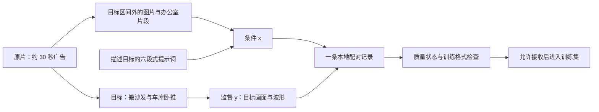

# 走读：把一个 raw_video 处理成 Ref2VA 训练样本

我们用仓库里已有的 [input.mp4](../ref2va-workspace/examples/input.mp4)，沿着 [设计文档](README.md) 的节点 `00 → 10` 走一遍。视频是一条约 30 秒的零食广告；这次要理解的是，程序如何从这段完整视频里选出参考和目标，最终组织成一条监督学习样本。

**先看最终配对：给模型两张人物/产品图片、一段办公室参考视频和目标提示词，让它学习输出原片里“搬沙发 + 车库卧推”的约 7.292 秒音视频。**

本文使用三种材料：

- **已有事实**：仓库样例的媒体、来源区间和标注；本次也重新检查了媒体解码、哈希与部分参数。
- **教学示例**：为解释新流水线而展示的配置和中间对象，未实际调用模型产生这些对象。
- **待实现逻辑**：`pipeline.pseudo.py` 中的调度、模型节点、缓存和发布接口。

这不是一次新流水线的运行报告。现有样例仍有一句对白待复核，因此它能展示完整的数据组织，但目前不能直接进入只接收 `completed` 的严格训练集。后面会具体说明它停在哪道检查，以及训练器最终会读取什么。

## 1. 先明确：一条 train sample 里有什么

可以把这条训练样本理解为下面的二元组：

```text
条件 x = 英文目标提示词
       + picture_1.png：主角外观、橙色手指、零食包装
       + picture_2.png：戴墨镜人物的外观
       + video_1.mp4：办公室片段的叙事结构及启用的声音风格

监督 y = target.mp4：搬沙发与车库卧推的真实画面
       + target_audio.wav：同一目标区间的真实声音
```

这里的 Ref2VA 是 reference-to-video-and-audio，即参考媒体驱动的音视频生成。数据构造阶段只把原片拆成条件与监督，不生成目标视频。



标注模型可以看目标，才能写出正确的监督文本。训练时，目标画面和目标波形进入监督分支；条件分支只能拿 `prompt` 和 `references`。完整原片 `oringin.mp4` 包含答案，只供溯源。

## 2. 节点 00：确定本次规则

对应伪代码：`run()` 开头的配置、规范与能力检查。

输入不是“请你自由发挥处理视频”，而是一份参数对象。下面是**教学配置片段**，省略项继承设计文档的默认值：

```yaml
workflow_version: stapipe-v1
workspace: ../ref2va-workspace
input_video: examples/input.mp4
max_samples: 1
media_profile: local_h3_v1
mode: record
search:
  max_tail_padding_seconds: 0.125
  max_tail_padding_ratio: 0.025
```

这里特意把尾部补齐比例设成 **2.5%**，与设计文档的默认 **2%** 区分开。原因来自真实样例：它的参考视频需要补 0.11925 秒，占原区间的约 2.072%，默认配置会拒绝这个参考。第 7 节会算一遍。

这个修改是为了用现有媒体贯穿教学，不能视为已经校准出的更优参数。本次不修改默认设计、不重导出媒体。实际新运行应记录这个配置差异，并重新验证所有相关检查。

程序还会固定模型版本、提示词模板、媒体规格和参考装载方式。比如本例的 `<Audio 1>` 来自参考视频内部音轨：必须由装载适配器明确支持这种映射。若没有确认这种能力，应改用已支持的参考组合，不能假定“文件里有声音就能正确装载”。

这一节点产出的核心是：**本次允许做什么、按什么规则做、失败后走哪个分支，都已经确定。**

## 3. 节点 01：把原片变成可寻址的媒体

对应伪代码：`probe_and_decode_entire_source()`、`assign_source_group()`。

本次重新读取实际文件得到：

| 属性 | 本例数值 |
| --- | --- |
| 输入文件 | `ref2va-workspace/examples/input.mp4` |
| 源视频尺寸 | 1280 × 720 |
| 解码帧数 | 720 |
| 源帧率 | `24000/1001` FPS（frames per second，每秒帧数），约 23.976 |
| 图像时间线长度 | `720 × 1001 / 24000 = 30.03` 秒 |
| 容器报告时长 | 约 30.05 秒，不能拿它替代逐帧边界 |
| 源音轨 | AAC（Advanced Audio Coding），44100 Hz，双声道 |
| 文件 SHA-256（Secure Hash Algorithm 256-bit） | `5e8b5cb5ccacc7a8a7233e3f2d6587471c5ad6883043f3f78058b891538b2f51` |
| 源作品分组 | 现有记录为 `aotw:can-t-touch-this-super-bowl` |

此时程序知道“第 200 帧在哪里”，还不知道“这段是否值得当目标”。

来源记录采用从 0 开始的帧号和左闭右开区间。例如 `[200, 374)` 包含第 200 帧到第 373 帧，共 174 个源帧，不包括第 374 帧。

本例可以用恒定帧率辅助理解位置：第 200 帧约在 `200 × 1001 / 24000 = 8.341667` 秒。通用实现仍须读取 PTS（presentation timestamp，显示时间戳）；不能把这个算式套到可变帧率视频上。

同一原片将来即使产出多条样本，也使用同一个 `split_group`。换编码版本不能直接当成新作品随机分到验证集。

## 4. 节点 02：理解内容，但先不选最终样本

对应伪代码：`build_source_timeline()`。

先看已有全片概览，理解原片的大致结构：


可以看到办公室、搬沙发、车库、后续室内和户外片段，主角、橙色手指、零食包装及戴墨镜人物多次出现。这给跨片段配对提供了可能。

真正运行时，程序按固定策略提供媒体：每秒概览帧、切镜两侧帧，以及 12 秒一窗、重叠 2 秒的视听窗口。本例大致是 `[0, 12)`、`[10, 22)`、`[20, 片尾)`。模型不能临时发起“再打开一个网站找剧情”等动作。

视觉模型负责把观察变成事件与主体记录；声音模型结合真实音轨和 ASR（automatic speech recognition，自动语音识别）结果建立声音记录。以下是**教学性中间对象**，仅展示一条事实的组织方式：

```json
{
  "event_id": "garage_sequence",
  "coordinate_system": "source",
  "observations": [
    "A man is bench-pressing in a garage.",
    "The recurring snack-eating man is seated nearby."
  ],
  "evidence_ids": ["source_garage_frames"],
  "audio_status": "requires_audio_evidence"
}
```

注意最后一个字段：看见卧推，不代表已经听到“喘气”或“金属碰撞”。模型只能把真正观察到的声音写入声音事实。

这一阶段得到的是全片事实索引 `timeline.json`。它让后面的选择器可以查询“哪里有完整动作”“哪里出现同一人物”，而不必让一个 agent 自行组织所有后续行动。

## 5. 节点 03：先选目标候选

对应伪代码：`enumerate_target_candidates()`。

程序用切镜、动作结束、语音停顿及固定时间网格构造候选区间，先过滤明显不合法的候选，再让固定模型节点判断语义完整性。最多 96 个进入密集理解，最多 24 个进入参考检索。

本例用已有样例的目标候选说明这一步：

```text
candidate_id          = target_200_374
source_frame_range    = [200, 374)
source_time_range     = [8.341667, 15.598917) 秒
source_duration       = 7.25725 秒
content               = 搬沙发 + 车库卧推
```


这段适合拿来讲解，因为它有两个可描述的小情节：别人需要帮助，主角拿着零食举起沾粉的手指，戴墨镜人物以意外方式出现。它也留下了办公室及后续片段作为参考来源。

已有资料只证明这个候选被历史样例采用，**不证明静态选择器运行后一定把它排第一**。本文不编造候选分数或模型调用日志。真实运行必须保存完整候选表、评分分量和淘汰原因；最后一条成品只是选择结果，不能替代这些记录。

一些拒绝条件可以直接理解：整段约 30 秒原片超过目标上限；在一句话或动作中途截断的候选不能因长度合适就通过；目标本身合格但找不到有效参考时，需要尝试其他目标。

到这里，`target_200_374` 仍只是“值得找参考的候选”，尚未成为样本。

## 6. 节点 04：到目标之外找参考

对应伪代码：`find_reference_bundles()`。

固定检索器为当前目标查找图片、视频、音频候选，然后固定配对模型核实“参考到底提供了什么”。本例的历史组合如下：

| 参考 | 原片来源 | 给目标提供的信息 |
| --- | --- | --- |
| [picture_1.png](../ref2va-workspace/examples/pure/inputs/picture_1.png) | 第 409 帧，17.058708 秒 | 主角身份、橙色手指、零食包装；目标里的衣着单独描述 |
| [picture_2.png](../ref2va-workspace/examples/pure/inputs/picture_2.png) | 第 558 帧，23.27325 秒 | 戴墨镜人物的脸、发型和墨镜 |
| [video_1.mp4](../ref2va-workspace/examples/pure/inputs/video_1.mp4) | `[62, 200)`，2.585917–8.341667 秒 | 办公室里的求助、反应、拒绝和人物出现的叙事模式，以及启用的声音风格 |


时间关系可以排成一条线：

```text
源时间 / 秒
2.585917              8.341667              15.598917   17.058708        23.27325
|---- 参考视频 ---------|----- 目标视频 --------|             ↑                ↑
                                                       Picture 1        Picture 2
```

参考视频恰好在目标开始处结束，因为区间右端不包含，所以二者不相交。两张图片都来自目标之后；参考并不要求出现在目标之前。

这里有三类判断，分别由固定节点承担：

1. **程序检查时间。** 把 `[200, 374)` 自己当参考视频，立即因交叠被拒绝。
2. **内容检查排除重复镜头。** 时间不同也可能是回放，仍需比较实际内容。本例办公室与搬家/车库画面不同，但完整近重复检查仍须实际执行。
3. **配对模型确认用途。** 身份相同支持身份参考；办公室的叙事模式支持结构参考，不能写成把办公室动作逐帧搬到车库。

某条关系可以存成如下**教学对象**：

```json
{
  "reference_id": "picture_1",
  "target_subject_or_event_id": "snack_eater",
  "role": "identity_and_visible_attributes",
  "promised_attributes": ["face", "hair", "orange_dusted_fingertips"],
  "changed_attributes": ["clothing", "background"],
  "relation_marker": "fully_preserved",
  "reference_evidence_ids": ["source_frame_409"],
  "target_evidence_ids": ["target_shots_1_3_4_6"]
}
```

这里 `fully_preserved` 只承诺定义中的脸、头发和手指特征，不承诺参考图片的衣着和背景。若定义里把衣着也列为保留属性，就必须改写定义或关系标记。

办公室视频虽紧挨目标，也不能仅凭时间相邻标成 `video continuation`。本例采用 `[reference generation + audio reference]`：画面结构提供生成参考，声音提供风格参考，未声称波形被复制。

程序选择参考集合时，还会比较更少参考的方案。已有样例采用两图一视频，不代表每份参考都不可替代；如果图片已经充分提供所需条件，无用的视频应当删掉，并同步移除对应的提示词关系。

## 7. 节点 05：把源区间导出成合法媒体

对应伪代码：`plan_legal_video()` 和 `build_pair()` 的导出部分。

### 7.1 目标为什么是 175 帧

目标源区间长度为 7.25725 秒。本地规格要求导出为 24 FPS，且帧数满足 `N = 17k + 5`。

| 候选帧数 N | 导出时长 N/24 | 对本例的影响 |
| --- | --- | --- |
| 158 | 6.583333 秒 | 比确认的源区间短，会截掉内容，不采用 |
| 175 | 7.291667 秒 | 只需末尾补 0.034417 秒，采用 |
| 192 | 8 秒 | 需补 0.74275 秒，超过补齐上限 |

174 个源帧与 175 个导出帧不矛盾：源视频约 23.976 FPS，导出视频为 24 FPS，还需要满足帧数对齐约束。

目标补齐比例为 `0.034416667 / 7.25725 ≈ 0.474%`，同时满足 0.125 秒和默认 2% 两条限制。导出器只重复目标末帧并为末尾补静音，不读取第 374 帧之后的新镜头。

### 7.2 真实样例如何检验默认配置

参考视频的源区间为 5.75575 秒，已有导出为 141 帧：

```text
参考导出时长 = 141 / 24 = 5.875 秒
需要补齐     = 5.875 - 5.75575 = 0.11925 秒
补齐比例     = 0.11925 / 5.75575 ≈ 2.072%
```

所以，默认配置下的判断是：

```text
0.11925 <= 0.125 秒       → 通过绝对时长限制
2.072% <= 2%             → 不通过比例限制
```

`plan_legal_video()` 应返回无可用计划，选择器尝试其他自然边界、参考或组合。它不会让 LLM 临时决定“放宽一点”，也不会截掉参考片段末尾来凑帧数。拒绝这个参考并不意味着整条原片被 `skipped`。

为了继续展示已有样例，本文的教学配置在**运行前**明确采用 2.5%；此时该补齐方案通过数值限制，但仍须核验末尾定格和声音补齐是否影响语义。更宽松的数值门槛不自动代表内容更合格。

### 7.3 画布和声音怎么变

画面处理沿用已有来源记录：

```text
1280 × 720 → 等比缩放到 1344 × 756 → 上下各补 6 像素 → 1344 × 768
```

目标声音直接从原片的目标区间提取，重采样到 32000 Hz 双声道，写成 16-bit PCM（pulse-code modulation）WAV（Waveform Audio File Format）。每声道采样数为：

```text
S = round(175 / 24 × 32000) = 233333
视频时长 = 7.291666667 秒
波形时长 = 233333 / 32000 = 7.29165625 秒
差值     ≈ 0.000010417 秒 < 一个采样点 0.00003125 秒
```

目标 MP4（MPEG-4 Part 14）的 AAC 音轨由同一目标波形编码。AAC 的容器时长或解码尾部可能包含编码填充，不能仅凭容器小数不同判断音画不同步；仍需核验内容与时间线。

这一步的暂存目录已经有真正的图片、参考视频、目标视频、目标 WAV 和原片副本，但尚未发布 `completed` 记录。

## 8. 节点 06：在导出结果上重新建立事实

对应伪代码：`build_pair()` 中的 `exported_visual_facts`、`exported_audio_facts`。

现在模型观察的是导出的 175 帧目标。时间从零开始；源片的 `8.341667` 秒不再是目标镜头时间。

已有样例提示词记录了以下六镜头时间。对应帧号按导出 24 FPS 换算列出，**本次没有重新完成逐帧切镜确认**；实际流水线须在导出文件上测量和复核。

| 镜头 | 导出起始帧 | 目标相对时间 | 画面内容 |
| --- | --- | --- | --- |
| Shot 1 | 0 | 0 | 搬沙发的远景，主角在旁边拿着零食 |
| Shot 2 | 29 | 1.208333 秒 | 搬运工近景，出现待复核短句 |
| Shot 3 | 51 | 2.125 秒 | 主角举手，戴墨镜人物从地毯卷中出现 |
| Shot 4 | 88 | 3.666667 秒 | 车库卧推远景 |
| Shot 5 | 112 | 4.666667 秒 | 卧推者近景 |
| Shot 6 | 133 | 5.541667 秒 | 主角再次举手，戴墨镜人物从绿色水管后出现 |

事实表不只保存剧情，还应保存每个镜头的主体、位置、动作、声音证据及不确定性。例如声音字段可以表达：

```json
{
  "event_id": "mover_request",
  "coordinate_system": "exported_target",
  "review_span_seconds": [1.2, 2.6],
  "speaker_key": "mover",
  "language": "English",
  "text": "[unclear]",
  "needs_review": true
}
```

历史 ASR 曾给出 `Help me.`，但两个词的置信信息较低，已有样例因此没有把它当作确定台词。本次未新增听辨确认，继续保留 `[unclear]`。这展示了模型输出如何成为证据，而不是直接变成真值。

## 9. 节点 07：将事实变成 H3 提示词和本地记录

对应伪代码：`allocate_stable_labels()`、`prompt_writer`、`render_six_sections()`。

### 9.1 先给素材与主体编号

新设计按目标首次出现顺序给 Subject 编号。本例第一镜头的主角与零食袋按稳定次序编号，戴墨镜人物随后出现：

| 标签 | 本次教学映射 |
| --- | --- |
| `<Picture 1>` | 第 409 帧的参考图片 |
| `<Picture 2>` | 第 558 帧的参考图片 |
| `<Video 1>` | 办公室参考视频 |
| `<Audio 1>` | `<Video 1>` 启用的同步音轨，没有第二份音频文件 |
| `<Subject 1>` | 主角 |
| `<Subject 2>` | 零食袋 |
| `<Subject 3>` | 戴墨镜人物 |
| `(S1)` | 搬运工的发声身份 |
| `(S2)` | 戴墨镜人物的发声身份，沿用现有标注，实际运行需视听复核 |

现有历史提示词把戴墨镜人物编为 Subject 2、零食袋编为 Subject 3。新规则会交换这两个编号，必须在全文一起更新；本文的教学片段使用上表的新编号，原文件不变。同一帧首次出现多个主体时，也要固定同分排序规则，不能依赖模型返回数组的偶然顺序。

Picture、Subject 和说话人是三套编号。搬运工没有外观参考，仍然可以是 `(S1)`；不是所有目标人物都必须拥有 Subject 标签。

### 9.2 模型写内容，程序写结构

| 六段 | 这条样本需要表达什么 |
| --- | --- |
| `subject_definitions` | 主角、零食袋、戴墨镜人物，以及视频结构与音频风格的定义 |
| `summary` | 约 7.292 秒，搬沙发与车库两个场景，使用哪些参考 |
| `retention_analysis` | 哪些属性保留；视频结构为 `weak_reference`，声音为 `reference` |
| `detailed_description` | 风格开头、六个镜头、对应动作与对白 |
| `overall_soundscape` | 有证据支持的环境声与物理声音 |
| `non_diegetic_music` | 目标配乐及其参考关系，不声称波形复制 |

例如 Subject 定义的一行可以是：

```text
<Subject 2> is the orange-and-white snack bag held by <Subject 1> in <Picture 1>, with the visible words "Cheetos" and "POPCORN".
```

第二镜头的**局部教学片段**可以是：

```text
[Shot 2] At 00:01.208, the camera cuts to a closer side view of the capped mover crouching under the sofa. The mover (S1) makes a short request in English, <d>[English] [unclear]</d>
```

其中 `00:01.208` 由第 29 帧换算并格式化，模型不能任意写成原片的 9 秒多。`[unclear]` 同时关联质量标记和复核区间。

完整历史提示词可在 [dataset.jsonl](../ref2va-workspace/examples/pure/dataset.jsonl) 的 `prompt` 字段查看。上面两段只解释转换方式，不是可单独提交的完整提示词。

### 9.3 序列化成一条记录

下面是**记录组装示意**；`rendered_prompt` 必须是完整六段文本，不能把变量名或省略号写进最终数据。JSONL（JSON Lines）文件最终只有一行，由 JSON（JavaScript Object Notation）序列化工具处理换行转义。

```python
record = {
    "id": "stapipe_demo_5e8b5cb5_001",  # 教学 ID；实际由源、运行及配对标识生成
    "split_group": "aotw:can-t-touch-this-super-bowl",
    "path_base": "directory containing dataset.jsonl",
    "prompt": rendered_prompt,
    "references": [
        {"type": "image", "label": "<Picture 1>", "path": "inputs/picture_1.png"},
        {"type": "image", "label": "<Picture 2>", "path": "inputs/picture_2.png"},
        {
            "type": "video", "label": "<Video 1>", "path": "inputs/video_1.mp4",
            "include_audio": True, "audio_label": "<Audio 1>"
        }
    ],
    "target": {
        "video": "targets/target.mp4",
        "audio": "targets/target_audio.wav",
        "width": 1344,
        "height": 768,
        "num_frames": 175,
        "fps": 24,
        "audio_sample_rate": 32000,
        "audio_channels": 2,
        "waveform_samples_per_channel": 233333
    },
    "needs_audio_review": True,
    "uncertain_audio_spans_seconds": [[1.2, 2.6]]
}
```

参数取自导出文件的实测结果，不能仅因为导出命令里写了 `175` 就认为实际一定是 175 帧。

## 10. 节点 08、09：检查与一次修复

对应伪代码：`verify_program_contracts()`、`semantic_auditor`、`prompt_repair`。

程序检查格式、路径、帧数、时长、来源交叠、标签和音频参数；固定审查模型同时查看真实导出媒体与提示词，检查事实是否一致。

用本例说明几种结果：

| 检查发现 | 固定处理 |
| --- | --- |
| 提示词写了“主角穿参考图里的衣服”，与目标衣着不符 | 如果事实表已经确认目标衣着，允许修正文案一次，然后重新审查 |
| 提示词引用 `<Audio 2>`，但编号表只有 `<Audio 1>` | 修正标签后重新校验，不新增一个无用途的音频文件 |
| 目标短句不能可靠听清 | 写 `[unclear]`，保存 `[1.2, 2.6]` 和 `needs_audio_review: true` |
| 参考与目标实际上是重复播放的同一镜头 | 淘汰配对，不能靠把提示词写得更好来通过 |
| 模型没有接收到实际画面 | 不能填视觉核验 `passed`；必要能力缺失时阻塞 |

修复节点不会创造新素材，也不更改选段。若第一次修复后还有已知事实错误，就拒绝这个配对，不继续让模型反复尝试直到给出好看的报告。

本次写文档实际做过的检查，与未来流水线必须做的检查分开列：

| 本次文档核对项目 | 结果/范围 |
| --- | --- |
| 原片、参考视频、目标视频完整解码 | 通过，解码帧数分别为 720、141、175 |
| 以上三个视频的哈希与来源记录 | 一致 |
| 原片与 `oringin.mp4` 哈希 | 一致 |
| 目标 WAV 采样率、声道、位宽、采样数 | 32000 Hz、双声道、16-bit、每声道 233333 |
| 目标/参考的合法帧数、时长和补齐计算 | 已核对，发现参考不满足默认 2% 比例限制 |
| 已有概览、目标分镜与参考分镜 | 已查看；不等同于重新逐帧验证全部动作 |
| 新模型标注、完整近重复检测、逐帧切镜与音画内容对齐检查 | 本次未执行 |
| 新增人工听辨、H3 推理或训练 | 本次未执行 |

已有 [package-verification.json](../ref2va-workspace/examples/evidence/package-verification.json) 的 `passed` 表示历史打包完整性检查通过，不能据此推出声音已确认，更不能直接当作新流水线的 `completed`。

## 11. 节点 10：发布什么，暂时不发布什么

对应伪代码：`classify_sample()`、`commit_without_overwrite()`。

**假定新运行的其余必需检查均通过**，这条含未知对白的样本应当是 `needs_review`。如果使用教学配置，它可进入待复核产物目录；严格训练集入口仍然拦截它。

示意发布结果为：

```text
outputs/<source_id>_<run_id>/<sample_id>/
├── pure/
│   ├── dataset.jsonl
│   ├── oringin.mp4
│   ├── inputs/
│   │   ├── picture_1.png
│   │   ├── picture_2.png
│   │   └── video_1.mp4
│   └── targets/
│       ├── target.mp4
│       └── target_audio.wav
└── work/
    ├── selection.json            # 为什么选这些素材
    ├── provenance.json           # 原始位置、变换、补齐与哈希
    ├── facts.json                # 导出媒体上的事实与未知项
    ├── labels.json               # 标签与素材/主体对应
    ├── prompt.md                 # 与记录完全相同的提示词
    ├── verification.json         # needs_review 及具体原因
    └── model_calls/              # 实际运行时保存的请求与响应
```

先在暂存目录生成、验证，再提交完整结果；上述目录不是本次新创建的数据样本。

若要让它变成严格训练集可接收的 `completed`，需要解决未知对白并重跑受影响的提示词与语义检查，或者按预定搜索流程选择可可靠标注的其他目标。不能只把布尔值改成 `false`。如果内容仍无法确认，保留 `needs_review` 就是正确结果。

## 12. 训练器实际会读到什么

这一步是设计文档边界之外的训练打包层，用来说明 `train sample` 的最终含义。它先过滤质量，再适配具体训练框架；`pure/dataset.jsonl` 是本地中间格式，不会自动变成某个框架的原生输入。

```python
def make_training_example(record, verification, committed, training_profile):
    if not committed or verification["status"] != "completed":
        return None  # 本例当前会在这里被严格训练入口拦截

    check_media_matches_training_profile(record["target"], training_profile)
    return {
        "condition": {
            "text": record["prompt"],
            "media": load_only_declared_references(record["references"])
        },
        "supervision": {
            "video": decode_target_video(record["target"]["video"]),
            "audio": decode_target_wav(record["target"]["audio"])
        }
    }
```

如果未来复核通过，并采用与此样本匹配的训练配置，解码后的逻辑内容为：

| 分支 | 内容 |
| --- | --- |
| 文本条件 | 完整六段式提示词 |
| 图片条件 | 两张独立图片，经训练器规定的图像预处理 |
| 视频条件 | 141 帧办公室参考片段，24 FPS，5.875 秒 |
| 声音条件 | 上述视频中明确启用的一条同步音轨；不重复提交为独立文件 |
| 目标画面 | 175 帧，24 FPS，1344 × 768 |
| 目标波形 | 双声道，每声道 233333 个采样点，32000 Hz |

例如目标画面可表示成 `[175, 3, 768, 1344]`，目标波形可表示成 `[2, 233333]`；这是便于理解的张量维度示意，不是对所有训练器轴顺序或模型内部表示的承诺。

如果训练器配置只接收 124 帧，就不能把 175 帧直接截短后沿用本例提示词：第六镜头从第 133 帧才开始，会被截掉。应配置匹配的时长/尺寸，或重新选段、导出和标注。训练/验证划分还必须按 `split_group` 整组进行。

## 13. 用这个例子理解“可复现、可改进”

假设未来完成过一次正式运行，保存了所有模型调用和中间产物：

| 想做的事 | 怎样执行 |
| --- | --- |
| 重现为什么选了 `[200, 374)` | 用 `replay` 读取指定历史运行的事实、候选判断和配对判断，再按同样规则排序 |
| 检查重新调用模型是否仍选择同一目标 | 用 `refresh` 新建运行，保留旧结果，比较目标、参考、提示词和状态 |
| 把补齐比例从 2% 改成 2.5% | 改版本化配置，重跑帧数规划和依赖它的选材/导出/验证；不能把旧验收结果直接搬来 |
| 改善搬运工短句的标注 | 更换固定声音节点的模型或模板，重跑相关事实、提示词和语义检查 |
| 改善提示词文字 | 固定媒体与事实，修改写作模板，重跑写作和审查，比较事实错误是否减少 |

历史样例目前没有这套静态流水线的完整调用账本，所以不能仅凭已有 `dataset.jsonl` 宣称已经支持 `replay`。媒体可读取、选择可追溯、模型响应可重放、在线重跑结果相近，是几个不同层次。

读到这里，再回看设计文档时，可以把各阶段对上这条具体的数据变化：

```text
约 30 秒原片
  → 帧/时间/声音索引
  → 全片事件与主体事实
  → 目标候选 [200, 374)
  → 目标外的两张图片与办公室参考片段
  → 对齐后的 175 帧目标、141 帧参考及目标波形
  → 导出时间线上的六镜头事实与未知对白
  → 六段式提示词 + 本地 dataset.jsonl
  → 程序与语义检查、最多一次文本修复
  → needs_review 产物
  → 复核通过且训练配置匹配后，才进入严格训练集
```

模型在固定节点上判断内容，程序用固定规则推进这条链。这个例子里的 2.072% 补齐和未知对白，都能找到明确的处理节点、原因记录和下一步，不需要让 agent 临时发明流程。
